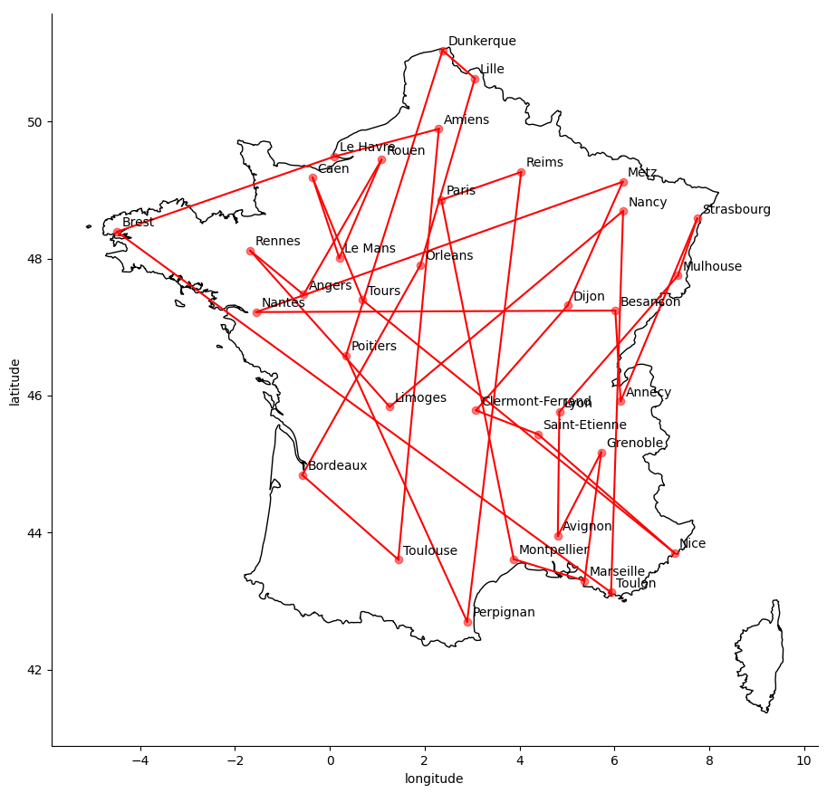
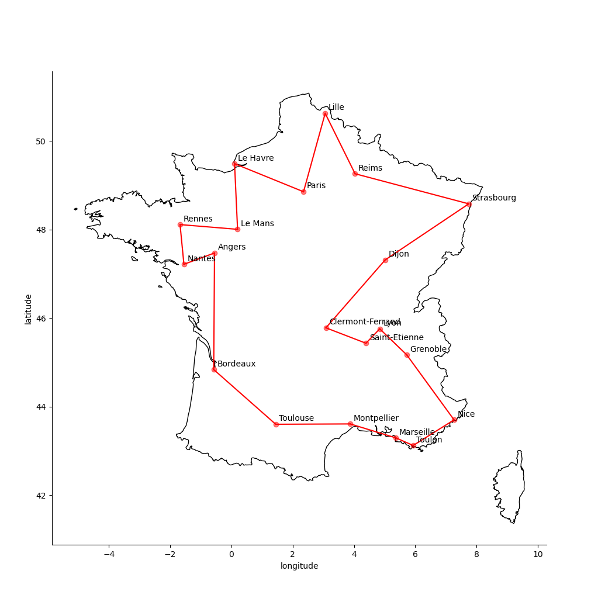
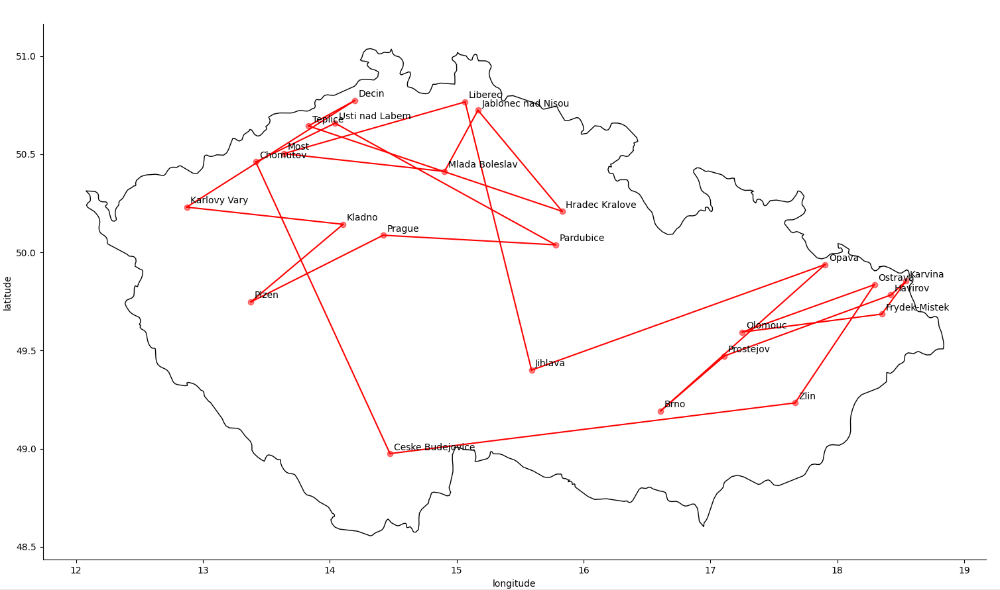
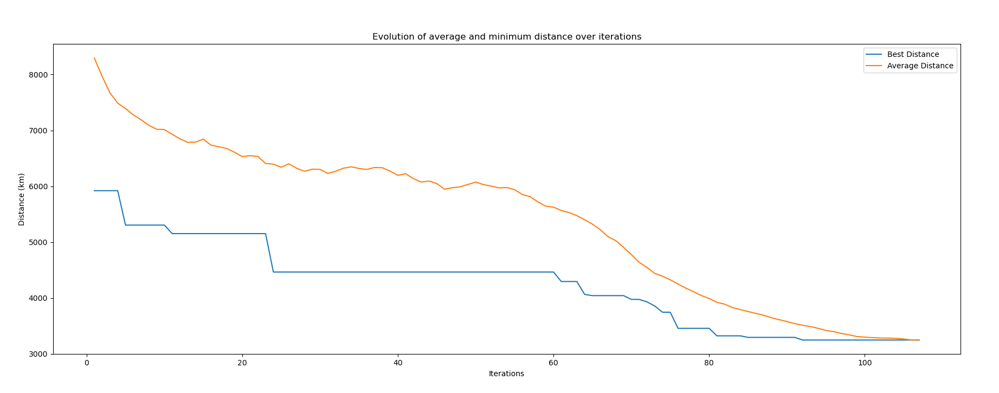

# Genetic TSP Solver



<p align="center">
  
  
</p>

## 🌟 Introduction

This project offers a Python-based solution to the classic **Traveling Salesman Problem (TSP)** using a genetic algorithm. It features an interactive GUI that allows you to visualize the algorithm's progress in real-time and analyze its performance.

The Traveling Salesman Problem is a famous NP-hard problem in computer science and operations research. The goal is to find the shortest possible route that visits a set of cities and returns to the origin city.

## ✨ Features

*   **Efficient TSP Solver:** Utilizes a genetic algorithm to find near-optimal solutions to the TSP.
*   **Interactive GUI:** A user-friendly interface built with `customtkinter` to control the algorithm's parameters and visualize the results.
*   **Real-time Visualization:** Watch the algorithm find the best route on a map with `geopandas` and `matplotlib`.
*   **Performance Analysis:** View graphs that show the evolution of the best and average route distances over generations.
*   **Real-world Data:** Uses real cartographical data from [Natural Earth](https://www.naturalearthdata.com/downloads/10m-cultural-vectors/10m-admin-0-countries/) and city data to create realistic TSP scenarios.

<details>
<summary>Click to see the screenshots</summary>

| Screenshot |
|:---:|
|  |
| *Execution with default parameters* |
|  |
| *Execution with Czechia, 25 cities, 0.005 mutation rate and 1 000 population size* |
|  |
| *Results of the default France execution* |

</details>

## 🚀 Getting Started

### Prerequisites

Before you begin, ensure you have Python 3.9 or later installed on your system.

### Installation

1.  **Clone the repository:**
    ```bash
    git clone https://github.com/AloisHasNeurons/Genetic_TSP_Solver.git
    cd Genetic_TSP_Solver
    ```

2.  **Create and activate a virtual environment:**

    *   **Using `venv`:**
        ```bash
        python -m venv .venv
        source .venv/bin/activate
        ```

    *   **Using `conda`:**
        ```bash
        conda create --name tsp_solver python=3.9
        conda activate tsp_solver
        ```

3.  **Install the dependencies:**
    ```bash
    pip install -r requirements.txt
    ```

### Usage

*   **GUI Mode:**
    To run the application with the graphical user interface, execute the following command:
    ```bash
    python gui/app.py
    ```

*   **Command-line Mode:**
    To run the application without the GUI, you can execute the `main.py` script:
    ```bash
    python genetic_algorithm/main.py
    ```

## 🛠️ Technologies Used

*   [Python](https://www.python.org/)
*   [customtkinter](https://github.com/TomSchimansky/CustomTkinter)
*   [geopandas](https://geopandas.org/)
*   [matplotlib](https://matplotlib.org/)
*   [pandas](https://pandas.pydata.org/)
*   [shapely](https://shapely.readthedocs.io/en/stable/manual.html)


## 📄 License

This project is licensed under the MIT License - see the [LICENSE](LICENSE) file for details.